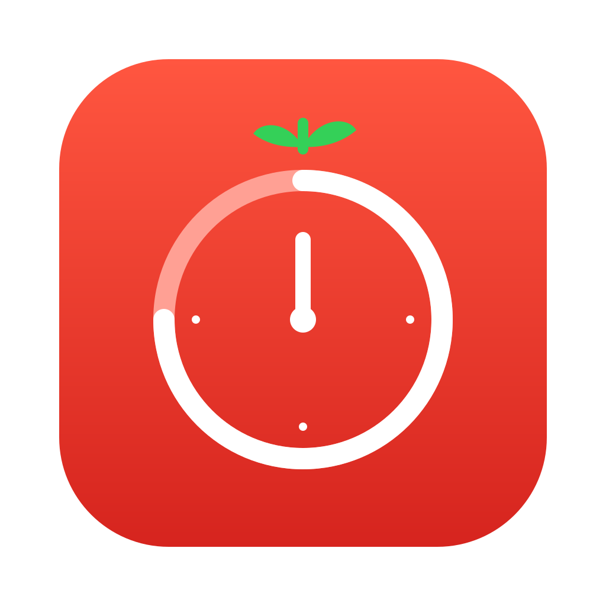
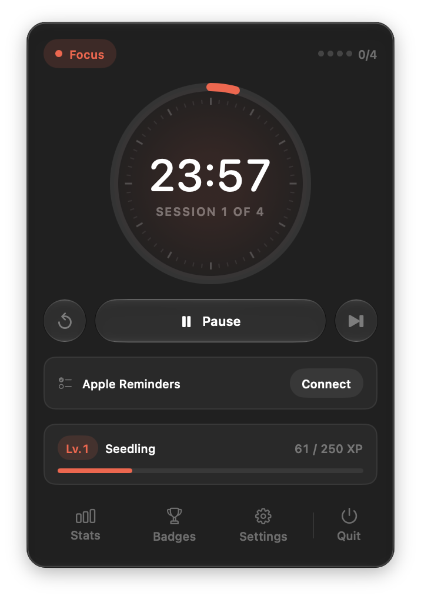
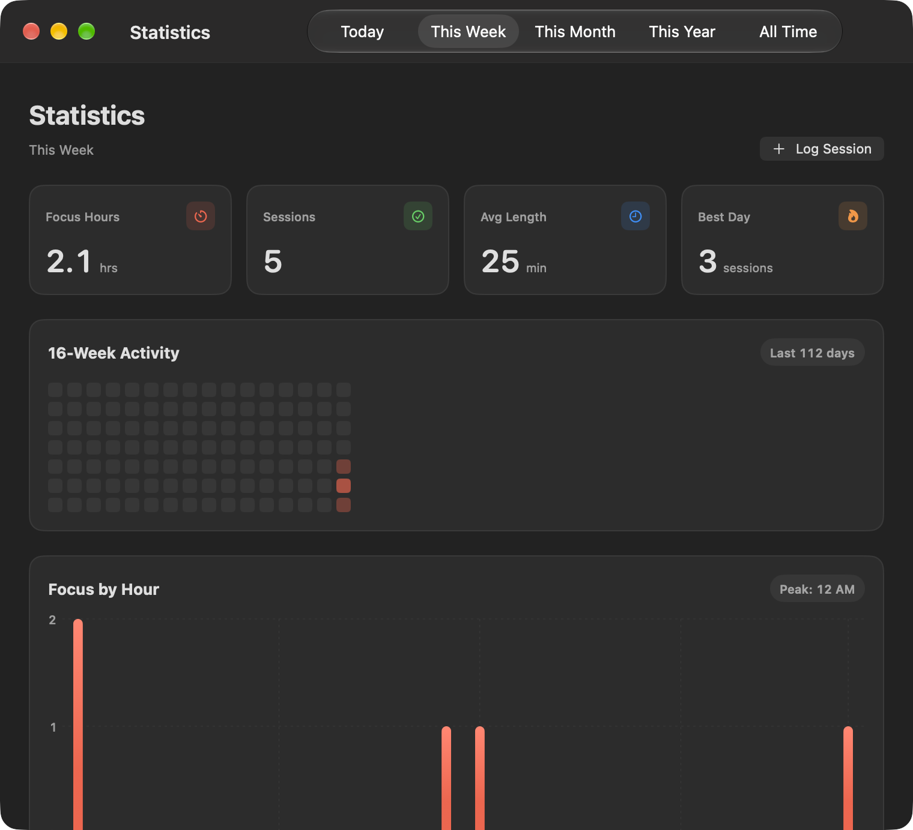
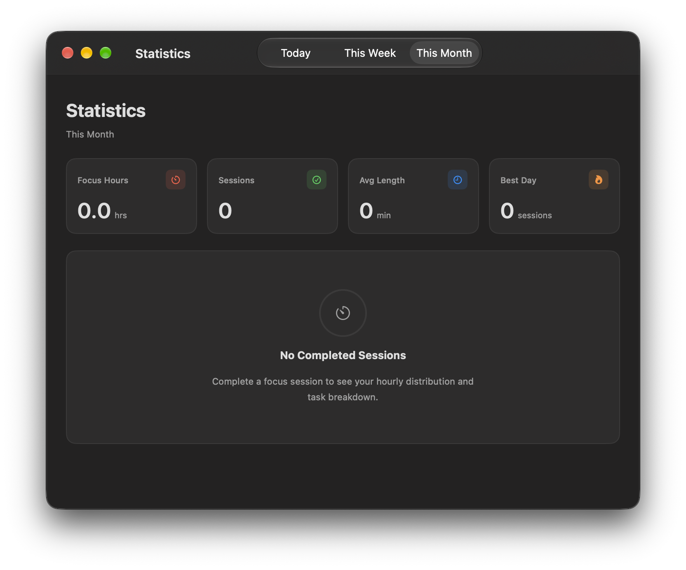
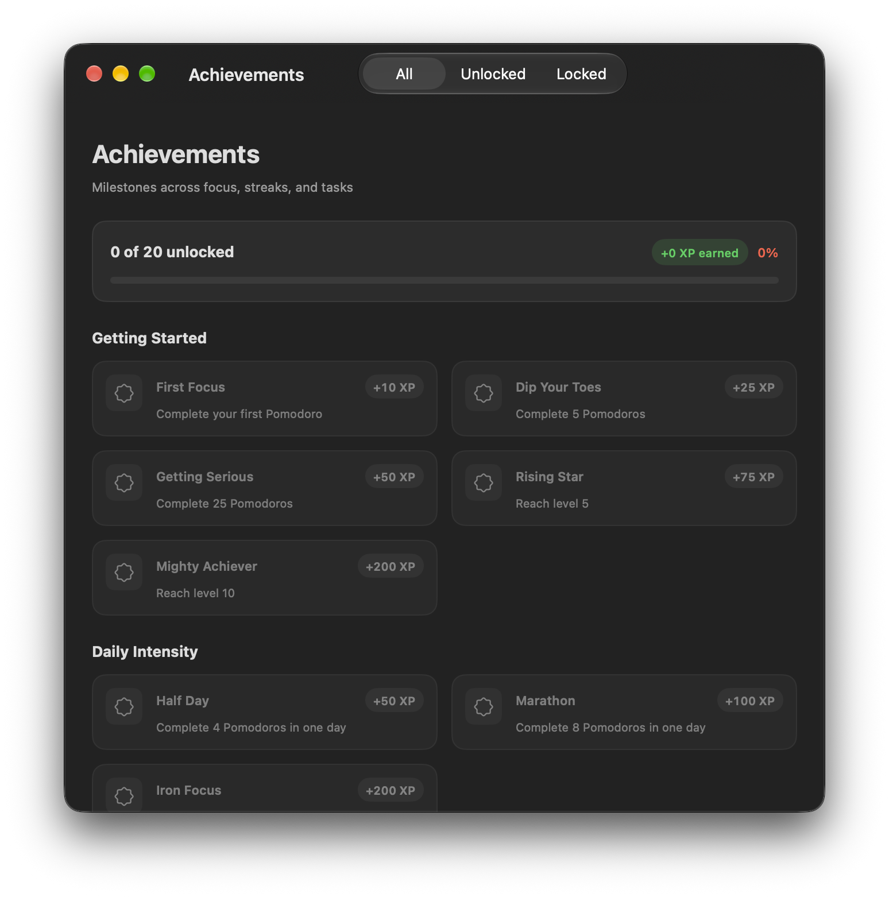

# FocusBar

<p align="center">
  
</p>

<h3 align="center">FocusBar</h3>

<p align="center">
  A Swiss chronograph-inspired native macOS menu bar Pomodoro timer.<br />
  100% Free &amp; Open Source — built with SwiftUI, SwiftData, Swift Charts, EventKit, and AppIntents.
</p>

<p align="center">
  <a href="https://aungmyokyaw.github.io/FocusBar/"><strong>Website</strong></a> ·
  <a href="https://github.com/AungMyoKyaw/FocusBar/releases/latest"><strong>Download v2.0.3</strong></a> ·
  <a href="#installation"><strong>Homebrew</strong></a>
</p>

<p align="center">
  <a href="https://github.com/AungMyoKyaw/FocusBar/actions/workflows/build.yml"></a>
  <a href="https://github.com/AungMyoKyaw/FocusBar/actions/workflows/release.yml"></a>
  
  
  
</p>

---

<p align="center">
  
  &nbsp;&nbsp;
  
</p>

## Highlights

- **Precision Chronograph Dial**: Radial dial with 60 perimeter ticks, tabular non-jitter countdown typography, quick `-5m` / `+5m` idle adjustments, `+5m` active extension, and optional **Overtime Mode** (`+MM:SS` count-up).
- **Draggable Multi-Size Floating Widget**: Pop out an always-on-top widget anywhere on screen with persistent placement and position lock. Right-click to switch between **Micro (Ring Only, 56×56)**, **Compact (Pill)**, and **Expanded (Dial)**.
- **Quick Tasks, Tags & Apple Reminders**: Log what you're working on inline with `#Coding`, `#Design`, `#Writing`, `#Study`, `#Planning` tags, or link active Apple Reminders tasks via EventKit with post-session completion prompts.
- **Apple Calendar & Shortcuts (`AppIntents`)**: Optional automatic time-block logging to Apple Calendar, native Siri/Shortcuts actions, `focusbar://` URL scheme (`start`, `pause`, `toggle`, `skip`, `reset`), and global hotkeys (`⌃⌥⌘S`, `⌃⌥⌘R`, `⌃⌥⌘N`).
- **Offline Ambient Soundscapes & Custom Chimes**: Synthesized **Brown Noise**, **Soft Rain**, and **Swiss Tick** via `AVAudioEngine` (zero audio files or network calls) plus customizable Focus/Break completion chimes.
- **Focus Protection**: Optional full-screen Liquid Glass break overlay, away/idle detection trim prompt (`CGEventSource`), and distracting-app activation nudges.
- **Analytics, Heatmap & Data Portability**: Today / Week / Month / Year / All-Time stats, 16-week contribution heatmap, manual session logging & history management, CSV & JSON export, deduplicated JSON restore, and in-app GitHub Releases update checker.
- **100% Free & Private**: Zero subscriptions, zero telemetry, sandboxed SwiftData storage.

---

## Screenshots

### Menu Bar Chronograph (Active & Ready)
| Active Focus Session | Ready State |
| :------------------: | :---------: |
|  |  |

### Analytics Dashboard
Comprehensive focus hours, completed session counts, average session lengths, best day tracking, 16-week heatmap, and hourly focus distribution charts.

| Today | This Week | This Month |
| :---: | :-------: | :--------: |
|  |  |  |

### Gamification & Achievements
Track your focus journey with 30-level progression (from *Seedling* to *Focus Master*), XP rewards, streak freezes, and 20 milestone badges.

| All Achievements | Locked Badges | Milestone Unlocks |
| :--------------: | :-----------: | :---------------: |
|  |  |  |

---

## Security & Code Signing

FocusBar is built with strict privacy and security guarantees:

- **Apple Developer Certificate**: Codesigned using an official Apple Developer ID certificate (`TeamIdentifier: ZSQUH7GKC5`).
- **Hardened Runtime**: Enabled with Apple runtime security mitigations (`flags=0x10000(runtime)`).
- **App Sandbox**: Fully sandboxed (`com.apple.security.app-sandbox = true`) with explicit user permissions for Apple Calendar and Reminders via EventKit.
- **Zero Telemetry**: No analytics, no trackers, no remote network calls. All Pomodoro history, achievements, and stats remain strictly on your device in SwiftData.

---

## Installation

### Homebrew Cask

```bash
brew install --cask aungmyokyaw/tap/focusbar
```

### Direct Download

1. Download the latest `FocusBar.app.zip` from [GitHub Releases](https://github.com/AungMyoKyaw/FocusBar/releases).
2. Unzip the archive.
3. Drag `FocusBar.app` into your `/Applications` folder.

---

## Usage & Shortcuts

| Action | Control / Shortcut |
| :--- | :--- |
| **Start / Pause / Resume** | Primary button, `Space` in popover, or global `⌃⌥⌘S` |
| **Reset Session** | `⌘R` in popover or global `⌃⌥⌘R` |
| **Skip Session** | `⌘→` in popover or global `⌃⌥⌘N` |
| **Floating Widget** | Click the PiP icon in the popover header; drag anywhere; right-click for Micro / Compact / Expanded sizes or Lock Position |
| **Ambient Soundscape** | Click the waveform icon in the popover header to cycle Off / Brown Noise / Soft Rain / Swiss Tick |
| **URL Scheme** | `focusbar://start?minutes=50&task=Ship+v2`, `focusbar://pause`, `focusbar://toggle`, `focusbar://skip`, `focusbar://reset` |

---

## Development

### Requirements

- macOS 14.0 (Sonoma) or later
- Xcode 15.0 or later
- Command Line Tools (`xcode-select --install`)

### Commands

```bash
# Build debug binary
make build

# Build universal release binary (arm64 + x86_64) signed with Apple Developer certificate
make release

# Verify code signature, team ID, and entitlements
make verify-signature

# Create release xcarchive
make archive

# Export for App Store Connect distribution
make export-appstore

# Run unit tests
make test

# Run UI tests
make ui-test

# Build and launch locally
make dev

# Stop running FocusBar instance
make stop

# Clean build artifacts
make clean
```

---

## Release Process

Push a semver version tag (`v2.0.3`) to trigger the GitHub Actions release workflow:
1. Runs full test suite (`FocusBarTests`).
2. Builds universal binary (`arm64` + `x86_64`).
3. Signs binary with Apple Developer certificate and Hardened Runtime.
4. Publishes GitHub Release with automated changelog and attaches `FocusBar.app.zip`.

---

## License

FocusBar is open-source software licensed under the [MIT License](LICENSE).
