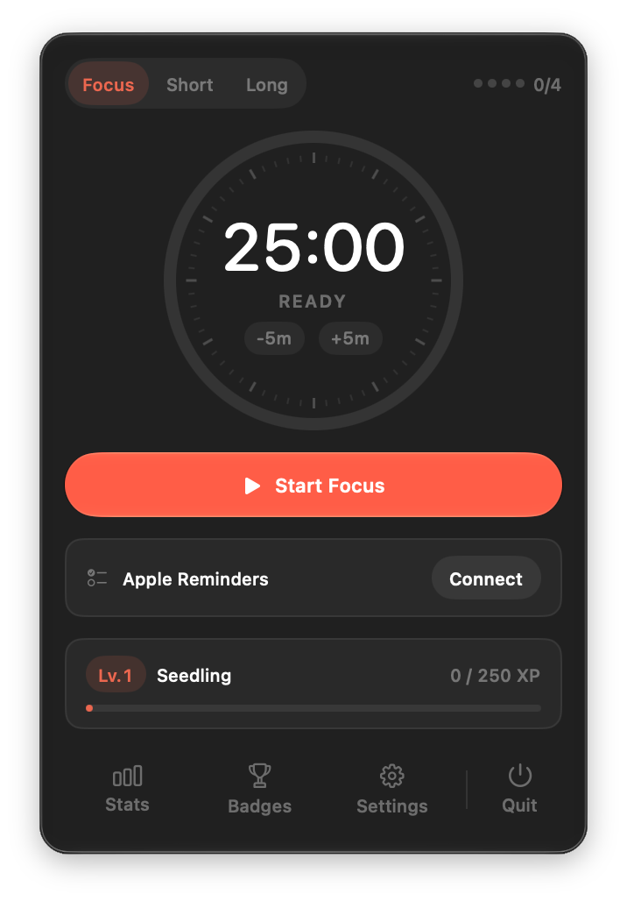
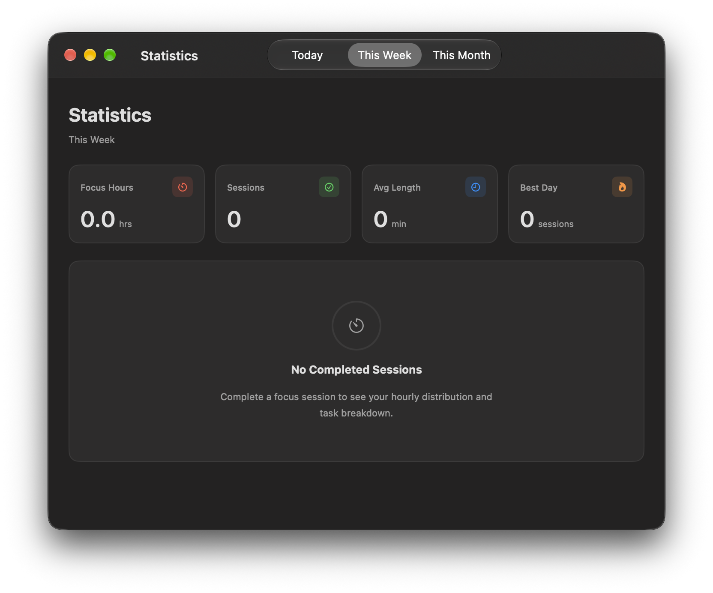
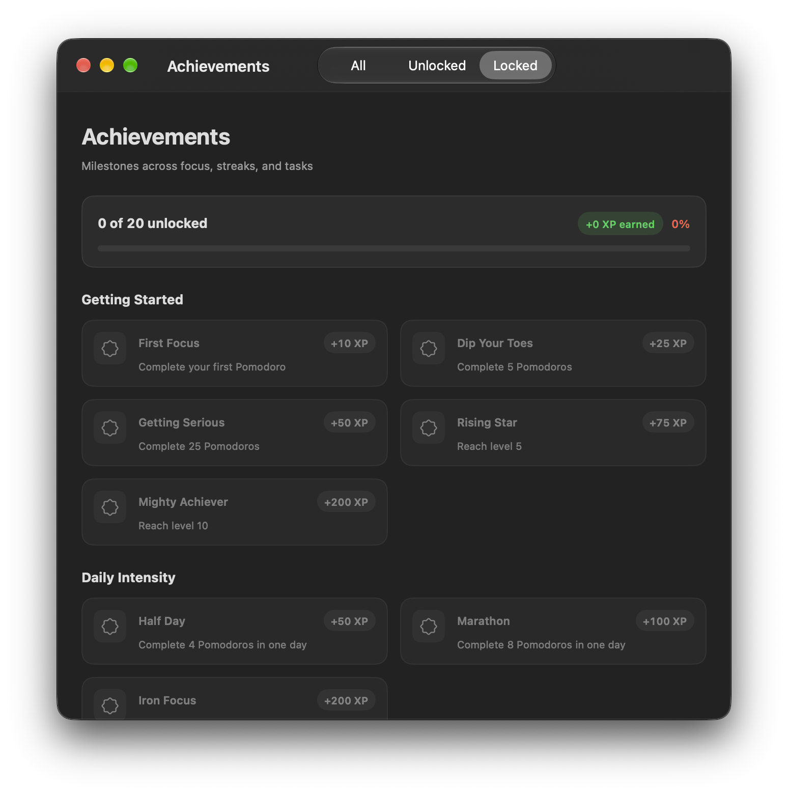
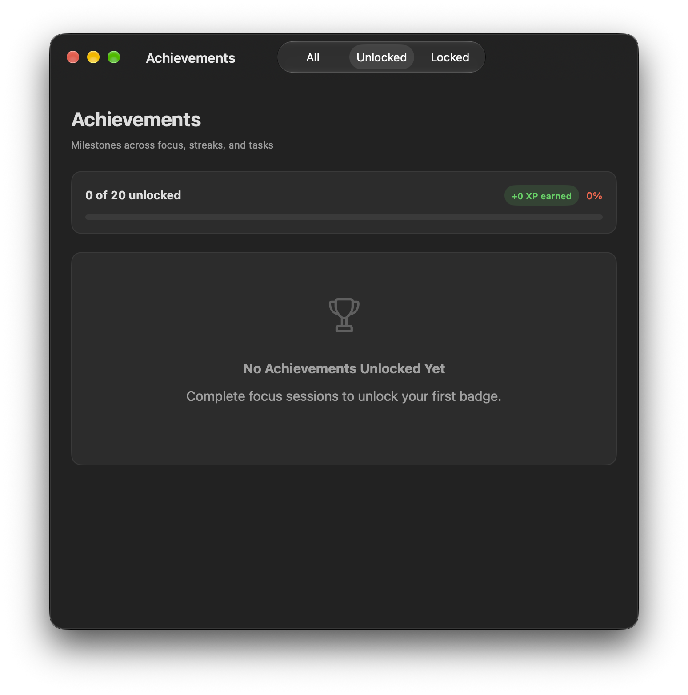

# FocusBar

<p align="center">
  
</p>

<h3 align="center">FocusBar</h3>

<p align="center">
  A Swiss chronograph-inspired native macOS menu bar Pomodoro timer.<br />
  Built with SwiftUI, SwiftData, Swift Charts, and Apple Reminders integration.
</p>

<p align="center">
  <a href="https://github.com/AungMyoKyaw/FocusBar/actions/workflows/build.yml"></a>
  <a href="https://github.com/AungMyoKyaw/FocusBar/actions/workflows/release.yml"></a>
  
  
</p>

---

<p align="center">
  
</p>

## Highlights

- **Precision Chronograph Dial**: Radial dial with 60 perimeter ticks, tabular non-jitter countdown typography, and quick `-5m` / `+5m` duration adjustments.
- **Sleep & Wake Resilient**: Anchor date-based timer engine that maintains accurate session timing across system sleep, lock screen, and wake cycles.
- **Apple Reminders Integration**: Select and link active Reminders tasks directly from the menu bar to log focused time without context switching.
- **SwiftData & Swift Charts Dashboard**: Comprehensive statistics broken down by Day, Week, and Month with hourly distribution and task allocation graphs.
- **Gamification & Streaks**: 30-level XP progression system, 20 milestone achievements, and daily streak tracking with automatic weekly freeze protection.
- **Privacy First & Local-Only**: 100% offline. Zero telemetry, zero analytics, no account registration, and sandboxed SwiftData persistence.
- **Refined macOS Craft**: Native materials, hairline card borders, and support for macOS Sonoma up to macOS Tahoe Liquid Glass.

---

## Screenshots

### Main Timer
<p align="center">
  
</p>

### Analytics Dashboard
Comprehensive focus hours, completed session counts, average session lengths, best day tracking, and hourly focus distribution charts across Today, This Week, and This Month.

| Today | This Week | This Month |
| :---: | :-------: | :--------: |
|  |  |  |

### Gamification & Achievements
Track your focus journey with level progression (from *Seedling* to *Focus Master*), XP rewards, and milestone badges.

| All Achievements | Locked Badges | Milestone Unlocks |
| :--------------: | :-----------: | :---------------: |
|  |  |  |

---

## Installation

### Homebrew Cask

```bash
brew install --cask aungmyokyaw/tap/focusbar
```

### Direct Download

1. Download the latest `FocusBar.app.zip` from [GitHub Releases](https://github.com/AungMyoKyaw/FocusBar/releases).
2. Unzip the archive.
3. Drag `FocusBar.app` into your `/Applications` folder.

---

## Usage

| Action | Control |
| :--- | :--- |
| **Start / Pause Focus** | Click the large primary action button or press Space |
| **Adjust Duration** | Click `-5m` or `+5m` pills inside the dial while idle |
| **Switch Session Mode** | Click `Focus`, `Short`, or `Long` break chips |
| **Link Apple Reminder** | Click `Connect` or tap the reminder pill to pick an active task |
| **Open Statistics** | Click `Stats` in the footer navigation |
| **Open Achievements** | Click `Badges` in the footer navigation |
| **Settings** | Configure auto-start, launch at login, sounds, and menu bar icon styles |

---

## Development

### Requirements

- macOS 14.0 (Sonoma) or later
- Xcode 15.0 or later
- Command Line Tools (`xcode-select --install`)

### Commands

A convenient `Makefile` is included for rapid development:

```bash
# Build debug binary
make build

# Run unit tests
make test

# Run UI tests
make ui-test

# Build and launch locally
make dev

# Stop running FocusBar instance
make stop

# Clean build artifacts
make clean
```

Or using `xcodebuild` directly:

```bash
# Build
xcodebuild -project FocusBar.xcodeproj -scheme FocusBar -configuration Debug build

# Unit tests
xcodebuild test -project FocusBar.xcodeproj -scheme FocusBar -destination 'platform=macOS' -only-testing:FocusBarTests
```

---

## Architecture & Tech Stack

- **UI & Layout**: SwiftUI with custom `FocusBarTheme` semantic tokens and radial canvas dial rendering.
- **State & Timing**: Combine + anchor date delta calculations (`TimerService`) resilient to thread throttling and display sleep.
- **Storage**: SwiftData models (`FocusSession`, `AchievementRecord`, `UserStreak`) local SQLite store.
- **Integrations**: EventKit for Apple Reminders authorization and item fetching.
- **Charts**: Swift Charts for hourly activity distribution.

---

## Release Process

Push a semver version tag (`v1.1.0`, `v1.2.0`) to trigger the GitHub Actions release workflow:
1. Runs full test suite (`FocusBarTests`).
2. Builds universal binary (`arm64` + `x86_64`).
3. Ad-hoc codesigns and zips `FocusBar.app`.
4. Publishes GitHub Release with automated changelog.

---

## License

FocusBar is open-source software licensed under the [MIT License](LICENSE).
